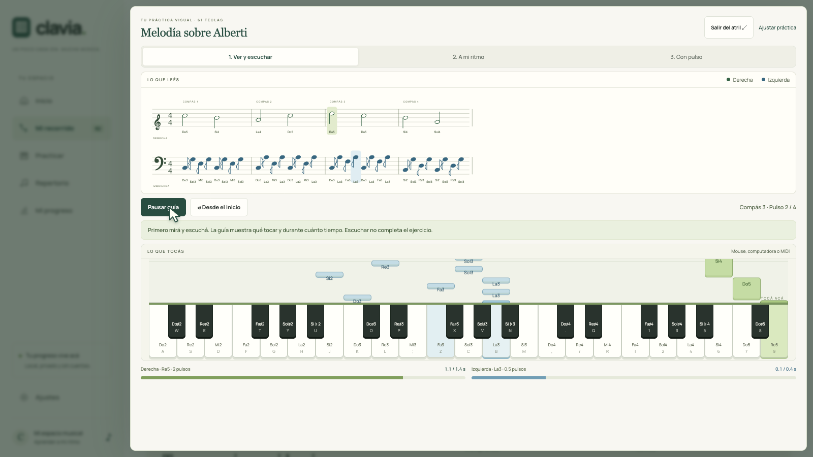

<div align="center">

# clavia.

### Tu música, a tu ritmo.

Aprendé teclado con partituras, guías de teclas, práctica MIDI y un camino musical completo. **Local, de código abierto y sin suscripciones.**

[Descargar Clavia](https://github.com/lucionigro/Clavia/releases/latest) · [Ver la demo](https://github.com/lucionigro/Clavia/releases/download/v1.2.2/Clavia-demo.mp4) · [Cómo empezar](docs/INSTALL.md) · [Importar partituras](docs/IMPORT.md)

[](https://github.com/lucionigro/Clavia/releases/download/v1.2.2/Clavia-demo.mp4)

</div>

## Empezá a tocar

1. Descargá el instalador de tu sistema desde **Releases** e instalá Clavia. No necesitás Node, una terminal ni una cuenta.
2. En el primer inicio elegí cantidad de teclas, registro, experiencia y la música que querés aprender.
3. Conectá el teclado con un **cable USB de datos**, encendelo y elegí **Buscar mi teclado MIDI**. Si hay varios dispositivos, seleccioná el tuyo en Ajustes.
4. Tocá una tecla: el monitor muestra la nota y su velocidad. También podés empezar con mouse, pantalla táctil o teclado de computadora.

| Tu equipo | Archivo en Releases |
| --- | --- |
| Mac Apple Silicon, M1 o posterior | `Clavia-1.3.0-mac-arm64.dmg` |
| Mac Intel | `Clavia-1.3.0-mac-x64.dmg` |
| Windows de 64 bits | `Clavia-1.3.0-windows-x64.exe` |
| Linux de 64 bits | `Clavia-1.3.0-linux-x86_64.AppImage` o `Clavia-1.3.0-linux-amd64.deb` |

**Versión comunitaria sin firma comercial.** Los paquetes no están firmados ni notarizados con Apple/Microsoft; el sistema puede advertir o bloquear su apertura. Consultá [instalación y compatibilidad](docs/INSTALL.md). La prueba con teclados físicos depende del modelo y del sistema: no se afirma compatibilidad probada con cada instrumento. Las compilaciones de otros sistemas deben distinguirse de una prueba física de ejecución y MIDI.

## Un recorrido para entender y hacer música

**82 lecciones originales en 12 bloques numerados**, de principiante a avanzado. Inicio, plan diario y «Siguiente lección» comparten un único orden. Las ocho áreas se pueden filtrar para repasar:

- Técnica y control: escalas, arpegios, cambios de posición e independencia.
- Lectura y ritmo: claves, armaduras, silencios, puntillos, ligaduras y síncopas.
- Barroco y contrapunto: imitación, secuencias y dos voces independientes.
- Clásico y romántico: Alberti, fraseo, forma, melodía acompañada, pedal y rubato.
- Oído y memoria: intervalos, ecos, acordes, cadencias y transporte.
- Improvisación: motivos, preguntas y respuestas, armonía y blues.
- Armonía y arreglos: cifrado, funciones, inversiones y conducción de voces.
- Interpretación y autonomía: preparar una obra, estudiar enlaces y escuchar las propias decisiones.

Cada lección reúne explicación, un ejemplo para tocar, una pregunta y un reto en el instrumento. Al empezar, el plan del día propone un solo siguiente paso, sin adelantar escalas o improvisación. Más adelante incorpora repaso, repertorio y creación.

**Completar una pantalla y dominar un instrumento son cosas distintas.** Clavia registra práctica y evidencia de ejercicios; no certifica un nivel de conservatorio. Para afianzar un ejercicio MIDI propone tres tomas con pulso, sin nombres de notas, en dos días: ≥95% de alturas y ≥90% de ataques/duraciones. Son criterios propios del producto. Postura, digitación física, tensión, calidad acústica, musicalidad y expresión requieren observarte, escucharte y recibir devolución cuando sea posible. [Método y límites](docs/LEARNING.md).

## De la partitura a tus manos

**Repertorio → Importar partitura** acepta:

- **MusicXML** (`.musicxml` o `.xml`) y **MXL** comprimido: alturas, duraciones, pentagramas, voces y ligaduras.
- **MIDI** (`.mid` o `.midi`): elegí las pistas de piano y la cuantización.
- Copias JSON exportadas por Clavia.

Asigná cada pentagrama a izquierda o derecha, seleccioná compases y revisá la guía. Al guardar aparecen **la partitura y las teclas animadas**, con duraciones y colores por mano. Podés estudiar una sola mano, cambiar el tempo, retirar ayudas y repetir un pasaje.

Un **PDF o una foto** necesita reconocimiento óptico antes de convertirse en notas. Clavia explica cómo usar Audiveris y revisar la conversión en un editor, sin subir tu archivo. Desde MuseScore podés exportar directamente MusicXML. [Guía y formatos compatibles](docs/IMPORT.md).

La notación de práctica es una representación simplificada: conservá tu edición original para detalles de grabado e interpretación. Las repeticiones/saltos se recorren una sola vez; cambios de compás y ciertos grupos especiales se rechazan para evitar una guía incorrecta. Pedal, ornamentos y variaciones de tempo no se evalúan como una edición completa.

## Un espacio para practicar y crear

- **Sonidos a elección:** piano de cola con muestras grabadas, piano suave, piano eléctrico y órgano. Elegilos y probalos en el primer inicio, Ajustes o teclado libre; la preferencia se guarda localmente.
- **Práctica visual:** clave de Sol y Fa, cascada de notas, teclado, duraciones independientes y modo atril.
- **A mi ritmo:** espera tus notas y verifica cuánto las sostenés.
- **Con pulso:** compara alturas, ataques y liberaciones con ventanas adaptadas a la subdivisión.
- **Oído activo:** ejemplos nuevos de melodía, ritmo y acordes, con respuesta oculta durante la escucha.
- **Improvisación:** acompañamiento de balada, ii–V–I y blues de doce compases; grabación y exportación de tu toma MIDI. Describe silencios, motivos y entradas, sin calificar creatividad.
- **Repertorio:** 15 arreglos incluidos a dos manos, favoritos, búsqueda por artista y un catálogo de 24 canciones para asociar archivos que tengas derecho a usar.
- **Tu progreso:** evidencia por área, repaso, historial creativo y un cuaderno privado de práctica.
- **Copia completa:** llevá progreso, perfil y arreglos importados entre el navegador y la app de escritorio.

Los temas comerciales del catálogo no incluyen transcripciones ni grabaciones. Los estudios incluidos son originales o arreglos propios de temas de dominio público, identificados individualmente.

## Local y tuyo

Sin cuentas, claves API, anuncios, analítica ni micrófono. El código de la app, fuentes, sintetizador y contenido incluido están empaquetados. Los archivos se procesan en el equipo. MIDI informa mensajes del teclado; no escucha su audio. El progreso y las partituras quedan en el almacenamiento local del navegador o de la app. **Borrar esos datos elimina el guardado: exportá copias.** [Privacidad](PRIVACY.md).

## Desarrollo

Necesitás Node.js 24 o posterior y npm.

```sh
git clone https://github.com/lucionigro/Clavia.git
cd Clavia
npm ci
npm start
```

Abrí `http://localhost:4173`. El servidor solo escucha en `127.0.0.1`. Podés cambiar el puerto con `PORT=4174 npm start`. La app de escritorio se abre con `npm run desktop`.

```sh
npm run check
npm test
npx playwright install chromium --with-deps  # Linux/CI; en macOS también puede usar Chrome instalado
npm run test:ui
npm run package:mac
npm run test:desktop
```

`test:desktop` usa un perfil temporal y requiere el paquete macOS arm64 ya construido. `CLAVIA_EXECUTABLE` permite probar otro ejecutable, por ejemplo el de un DMG publicado montado en modo lectura. Las pruebas automáticas de MIDI usan mensajes simulados y la API; no sustituyen conectar y calibrar un instrumento real.

La automatización de Releases compila macOS arm64/x64, Windows x64 y Linux x64. Las dependencias de desarrollo se fijan mediante `package-lock.json`; el renderer no incorpora Node y el servidor solo expone los recursos de la app. [Arquitectura, contribuciones y video](CONTRIBUTING.md).

## Licencia y créditos

Código y contenido original bajo [MIT](LICENSE), salvo indicación específica. El ejemplo `primer-dialogo.musicxml` se publica como CC0. Las obras históricas se identifican por su autor; las canciones comerciales solo aparecen como referencias de catálogo. Las fuentes locales y el descompresor conservan sus licencias en [THIRD_PARTY_NOTICES.md](THIRD_PARTY_NOTICES.md). El contenido se inspira en una formación equilibrada de técnica, repertorio, oído y lectura; no tiene afiliación ni aval de ABRSM o RCM.
